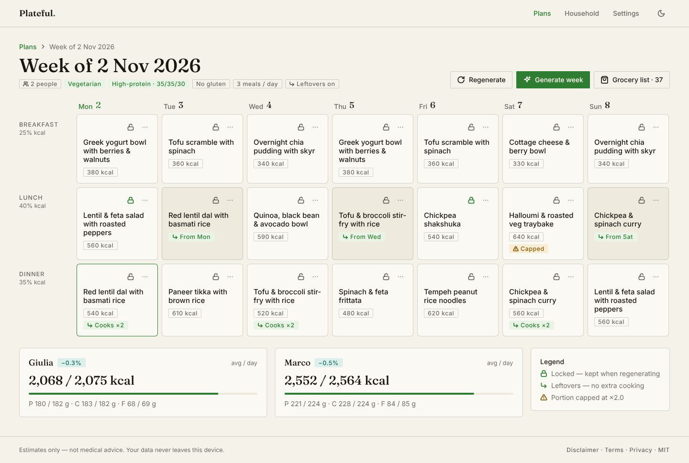
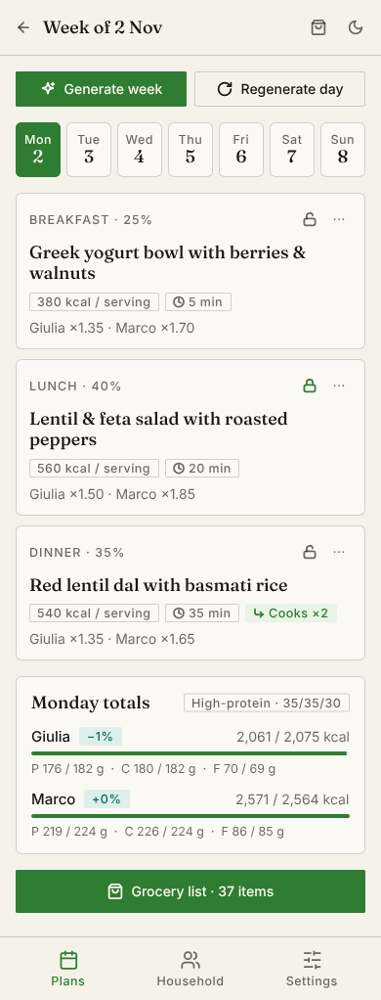
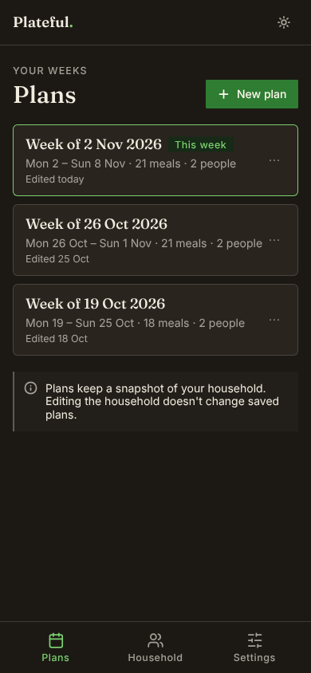
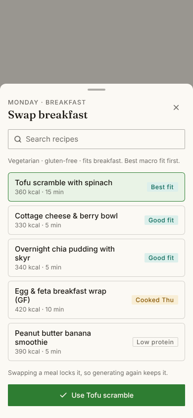

<div align="center">

# Plateful

**Plan a week of meals for your household and get the grocery list.**

Pick a diet and a macro profile, describe the people eating, and Plateful plans shared dishes with portions sized for each person, then adds up every raw ingredient you need to buy. Everything runs in your browser.

[](https://plateful.lucabonaldo.dev)
[](docs/REQUIREMENTS.md)
[](https://www.typescriptlang.org/)
[](https://react.dev/)
[](https://vite.dev/)
[](LICENSE)

[**Launch the app**](https://plateful.lucabonaldo.dev) · [Requirements](docs/REQUIREMENTS.md) · [Report an issue](https://github.com/LucaBonaldoIT/plateful/issues) · [Contributing](CONTRIBUTING.md) · [Security](SECURITY.md)

</div>

---

<p align="center">
  
</p>

<p align="center">
  
  &nbsp;
  
  &nbsp;
  
</p>

> [!NOTE]
> Plateful is in early development. The requirements are in [`docs/REQUIREMENTS.md`](docs/REQUIREMENTS.md) and the UI/UX design in [`docs/design`](docs/design).

## Overview

Plateful is a free, static, client-only web app. There's no backend, no account, no cookies and no tracking. Your household and plans are stored in your browser's local storage, and you can export, import or delete them at any time as a single JSON file.

## Features

- **Household:** any number of adults, each with sex, age, weight, height, activity level and goal (lose, maintain, gain). Calorie targets use Mifflin-St Jeor.
- **Diet types:** omnivore, flexitarian, pescatarian, vegetarian, vegan.
- **Macro profiles:** balanced, keto, low-carb, high-carb, high-protein, Mediterranean, zone, low-fat.
- **Allergen exclusions:** gluten, dairy, eggs, tree nuts, peanuts, soy, fish, shellfish, sesame.
- **Weekly plan:** 1–6 meals per day, generated automatically with variety rules, batch cooking and leftovers, and macro targeting. Swap and lock meals by hand.
- **Shared dishes, personal portions:** everyone eats the same meal, with each person's portion sized to their target.
- **Grocery list:** exact raw quantities plus suggested package sizes, grouped by aisle. Copy it to the clipboard as a checklist in one click.
- **Saved plans:** keep, rename, duplicate and reopen past weeks.
- **Your data, on your device:** JSON export, import and delete.
- **Bundled database:** 362 recipes, 187 of them vegan and 292 vegetarian, plus 204 ingredients with nutrition data from USDA FoodData Central.

## Tech stack

- [Vite](https://vite.dev/) + [React](https://react.dev/) + TypeScript (`strict`)
- [`@lucabonaldo/design`](https://github.com/LucaBonaldoIT/design) ("Paper & ink" design system) with a Leaf-green primary
- Zustand (state), Zod (schema validation), React Router (hash routes)
- Vitest + React Testing Library

## Getting started

### Prerequisites

- Node.js 20 or later
- npm 10 or later

### Run locally

```sh
git clone git@github.com:LucaBonaldoIT/plateful.git
cd plateful
npm install
npm run dev:lan
```

Open http://localhost:5180, or the `Network` URL Vite prints to try it on a phone on the same Wi-Fi.

### Scripts

| Command | Description |
| --- | --- |
| `npm run dev` | Dev server on http://localhost:5180 |
| `npm run dev:lan` | Dev server also reachable from your local network |
| `npm run build` | Type-check and build the static site into `dist/` |
| `npm run preview` | Serve the production build locally and on the network |
| `npm run check` | Type-check only |
| `npm test` | Unit tests (nutrition, generator, grocery list, import/export) |
| `npm run db:lint` | Validate the recipe database and print diet × slot coverage |
| `./build.sh` | Install dependencies if needed and produce the static site in `dist/` |
| `./scripts/og-image.sh` | Regenerate the social image and PNG icons in `public/` (needs Google Chrome) |

### Deployment

`./build.sh` (or `npm run build`) emits a fully static site in `dist/` with hash routes, so it runs on any static host without rewrites. Production is served from Cloudflare Pages at [plateful.lucabonaldo.dev](https://plateful.lucabonaldo.dev).

## Project structure

```text
plateful/
├── src/
│   ├── domain/           Pure TypeScript: nutrition, compatibility, generator, grocery list, schema
│   ├── data/             Ingredient table and recipes (data/recipes/: one file per category)
│   ├── state/            Zustand store, localStorage persistence, theme and cookie-notice prefs
│   └── ui/               React screens, components and app.css
├── scripts/              db-lint.ts (FR-DB-5), og-image.sh (social image and icons)
├── build.sh              Static build helper
├── docs/
│   ├── REQUIREMENTS.md   Product requirements, decision log, legal texts
│   └── design/
│       ├── screens/      PNG exports: foundations, mobile and desktop, light and dark
│       └── penpot/       Scripts that rebuild the Penpot file through the Penpot MCP
├── LICENSE               MIT
├── CONTRIBUTING.md
└── SECURITY.md
```


## Disclaimer

Plateful gives estimates, not medical or nutritional advice. Talk to a doctor or registered dietitian before changing your diet, and always check product labels for allergens. See the full [Disclaimer](docs/REQUIREMENTS.md#appendix-a--disclaimer).

## License

Source code is released under the [MIT License](LICENSE). © 2026 Luca Bonaldo.
