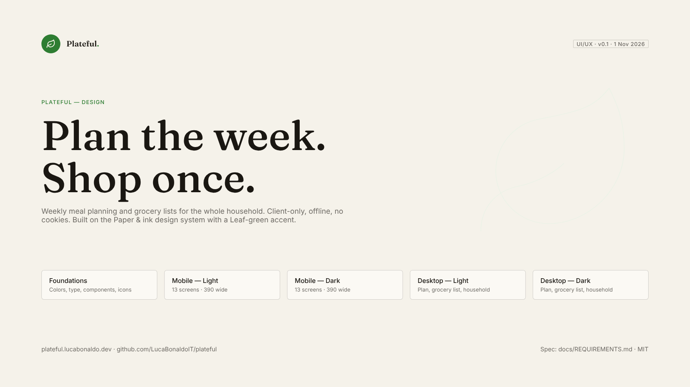

# Design

The UI/UX for Plateful, drawn in [Penpot](https://penpot.app/) on top of the
[`@lucabonaldo/design`](https://github.com/LucaBonaldoIT/design) ("Paper & ink") tokens with
a Leaf-green primary and teal success color (see
[REQUIREMENTS §13](../REQUIREMENTS.md#13-ui-and-design-system)).

  

## Contents

| Path                      | Contents                                                              |
| ------------------------- | --------------------------------------------------------------------- |
| `screens/foundations/`    | Color roles (light and dark), typography, components and icons        |
| `screens/mobile-light/`   | 13 mobile screens, 390 px wide, light theme                           |
| `screens/mobile-dark/`    | The same 13 screens, dark theme                                       |
| `screens/desktop-light/`  | Week grid, grocery list and household at 1440 px, light theme         |
| `screens/desktop-dark/`   | The same desktop screens, dark theme                                  |
| `penpot/`                 | Scripts that rebuild the whole Penpot file through the Penpot MCP     |
| `plateful.penpot`         | Penpot source file (exported from Penpot; see below)                  |

## Screens

Mobile, in flow order. Requirement IDs refer to [`REQUIREMENTS.md`](../REQUIREMENTS.md).

| #  | Screen                    | Covers                                                      |
| -- | ------------------------- | ----------------------------------------------------------- |
| 01 | Welcome & terms           | Key points, legal acceptance (FR-LEGAL-2), cookie notice (FR-LEGAL-6a) |
| 02 | Onboarding · Household    | People, diet, macro profile, allergens, compatibility (FR-HH-*) |
| 03 | Onboarding · Plan settings| Meals per day and slot shares, week, leftovers (FR-PS-*)    |
| 04 | Plans                     | Saved weekly plans (FR-PL-*)                                |
| 05 | Plan · day                | Day tabs, meal cards, lock, per-person totals (FR-WP-*)     |
| 06 | Meal · detail             | Portions per person, household ingredients, actions (FR-WP-4) |
| 07 | Meal · swap               | Compatible alternatives ranked by fit (FR-WP-8)             |
| 08 | Household                 | Same content as 02, in-app                                  |
| 09 | Person · edit             | Body data, activity, goal, live daily target (FR-HH-2, §6)  |
| 10 | Grocery list              | Aisle groups, exact amount + packages, copy toast (FR-GL-*) |
| 11 | Settings                  | Plan defaults, export / import / delete, about (FR-DATA-*)  |
| 12 | Delete dialog             | Destructive confirmation with "Export first" (FR-DATA-5)    |
| 13 | Privacy policy            | Legal page (Appendix C)                                     |

Desktop: **D1** week grid (7 days × slots), **D2** grocery list with a clipboard preview in the
exact FR-GL-5 format, **D3** household in two columns.

## The Penpot file

Pages: **Cover**, **Foundations**, **Mobile — Light**, **Mobile — Dark**, **Desktop — Light**,
**Desktop — Dark**. The file's local library contains:

- **38 colors**: every `--ds-*` role, once under `Light/` and once under `Dark/`. Shapes use these
  library colors, so a role change updates the design.
- **14 typographies**: `Display/*` (Fraunces) and `Text/*` (Inter).
- **30 components**: buttons, tags, chips, checkbox, toggle, stepper, segmented control, fields,
  notices, toast, meal cards and radio row.
- Every screen uses flex layouts, so boards resize with their content.

A named version, "v0.1 — initial UI/UX", is saved in the file history.

### Exporting the source file

The Penpot plugin API can't hand a whole file back to the repo, so export it by hand: in Penpot,
open the file menu, choose **Export .penpot**, and save it as `docs/design/plateful.penpot`.

## Rebuilding with the Penpot MCP

`penpot/` holds the scripts that generated everything here. With the Penpot MCP server
connected and an empty file open, run them in order through `execute_code` (they share state
through the plugin `storage` object):

1. `00-library.js`: colors, typographies, pages
2. `01-core.js`: primitives, icons, components
3. `02-data.js`: sample household, week, grocery list
4. `03-mobile.js`, then `await storage.buildMobile("light", "Mobile — Light")` and the same for dark
5. `04-desktop.js`, then `await storage.buildDesktopScreen("dPlan", "Desktop — Light", 0)` per screen
6. `05-foundations.js`, then `await storage.buildFoundations()` and `await storage.buildCover()`

Each MCP call times out after 120 seconds. Build large pages a few screens at a time. A timeout
can reload the plugin and clear `storage`; if it does, re-run parts 1–3 first.

## Sample content

The mockups show a two-person household: Giulia (34, 62 kg, 168 cm, moderate, maintain:
2,075 kcal) and Marco (36, 82 kg, 181 cm, high, lose: 2,564 kcal). It's vegetarian,
high-protein (35/35/30) and gluten-free, with 3 meals a day (25/40/35) and leftovers on. The
numbers follow the formulas in REQUIREMENTS §6.
